# 🧰 Developer Survival Kit

### *Production Blueprints, Zero-Cost Cloud Architectures, Open-Source Legal Shields, and High-Performance Execution Systems*

 

 

[-blue?style=flat-square&logo=github)](https://github.com/SagarBiswas-MultiHAT)

 

*Written in plain English so complete beginners and non-technical readers can understand every concept instantly, while delivering battle-tested blueprints for senior engineers, cybersecurity researchers, and students.*

[Free Hosting Guide](#-pillar-1-the-complete-guide-to-free-full-stack-web-hosting-2026) •
[License Guide](#-pillar-2-the-ultimate-guide-to-github--open-source-licenses) •
[GPG Signing Guide](#-pillar-3-the-ultimate-guide-to-github-gpg-commit-signing) •
[PRISM Routine](#-pillar-4-prism-study--execution-engine-v3) •
[Quick Navigator](#-quick-navigator-which-guide-do-you-need) •
[All Files](#-complete-survival-kit-catalog) •
[Dual Licensing](#-licensing-intellectual-property--anti-theft-terms) •
[Contributing](./.github/CONTRIBUTING.md)

---

## 🌟 What is the Developer Survival Kit?

The **Developer Survival Kit** is a curated, open-source battle-tested knowledge repository authored by **Sagar Biswas ([@SagarBiswas-MultiHAT](https://github.com/SagarBiswas-MultiHAT))**. It provides clear, actionable answers to four of the most critical questions faced by developers, students, and independent creators:

1. **How do I host web apps and portfolios 24/7 without paying $20 to $50 monthly or dealing with slow 50-second cold starts?**
2. **Which open-source license actually protects my code and roadmaps from being stolen or repackaged into paid courses, while maximizing GitHub stars?**
3. **How do I prevent strangers from forging my Git commits and push cryptographically verified code with the green GitHub badge?**
4. **How do I structure a 9+ hour daily study and technical execution schedule to master complex computer science topics and cybersecurity in 60 days?**

Every guide in this repository is built on empirical testing, verified against live platform documentation, and updated continuously for the 2026 developer ecosystem.

---

## 🧭 Quick Navigator: Which Guide Do You Need?

If you are new to this survival kit, use this 10-second directory to find the exact playbook for your current challenge:

| Your Current Goal or Question | Recommended Playbook | What You Will Learn | Reading Time |
| :--- | :--- | :--- | :---: |
| 🚀 **"I want to host my full-stack app for $0"** | [free-hosting-plan.md](./free-hosting-plan.md) | 9 platforms benchmarked (Render, Koyeb, Vercel, OCI), 24/7 keep-alive secrets, zero cold starts, and hosting 4+ live projects for $0 forever. | ~15 min |
| ⚖️ **"I want to pick the right open-source license"** | [github_open_source_licenses_guide.md](./github_open_source_licenses_guide.md) | Plain-English comparison of MIT, Apache 2.0, GPL, and CC BY-SA 4.0. Dual-licensing strategy to protect code + roadmaps in one repo. | ~20 min |
| 🔐 **"I want the green Verified badge on my commits"** | [github_gpg_commit_signing_guide.md](./github_gpg_commit_signing_guide.md) | How Git identity spoofing works, 5-minute Ed25519 GPG key setup, automated signing, and supply-chain defense. | ~12 min |
| 📚 **"I need a high-intensity study & work routine"** | [Routine_Study_v3.md](./Routine_Study_v3.md) | The PRISM methodology: 7h sleep anchor, 9h deep work, 5-subject cyclic rotation (~40h/subject), and a 4-stage cybersecurity progression. | ~15 min |
| 🥗 **"I want a daily nutrition plan for high focus"** | [Routine_Eating.md](./Routine_Eating.md) | দৈনিক খাবারের রুটিন: Personal daily nutritional discipline plan in Bengali, designed to sustain energy for 9+ hours of deep technical work. | ~8 min |

---

## 📂 Complete Survival Kit Catalog

All research guides, execution routines, and documents are stored in the repository root for immediate access:

| File | Domain | Target Audience | Primary Focus |
| :--- | :--- | :--- | :--- |
| [free-hosting-plan.md](./free-hosting-plan.md) | 🌐 Cloud Architecture | Full-Stack Developers, CS Students | Free full-stack hosting (2026), 9-platform breakdown, 24/7 keep-alive pings, zero cold starts |
| [github_open_source_licenses_guide.md](./github_open_source_licenses_guide.md) | ⚖️ Open-Source Legal | Repo Authors, Writers, Researchers | Plain-English license guide, MIT vs Apache vs GPL vs CC BY-SA, dual-licensing, DMCA takedowns |
| [github_gpg_commit_signing_guide.md](./github_gpg_commit_signing_guide.md) | 🔐 Security & Identity | Software Engineers, Git Users | Git identity spoofing defense, Ed25519 GPG key setup, GitHub green Verified commit badge |
| [Routine_Study_v3.md](./Routine_Study_v3.md) | 📅 Systems & Routines | Engineering Students, Researchers | PRISM Study Routine v3: 9h daily deep work, 5-subject rotation, cybersecurity roadmap |
| [Routine_Study_v3.docx](./Routine_Study_v3.docx) | 📄 Document | Engineering Students | Formatted Word document edition of the PRISM Study Routine v3 |
| [Routine_Study_v3_Bangla.docx](./Routine_Study_v3_Bangla.docx) | 📄 Document (Bengali) | Engineering Students | Bengali translation of the PRISM Study Routine v3 |
| [Routine_Eating.md](./Routine_Eating.md) | 🥗 Cognitive Health | Independent Learners | দৈনিক খাবারের রুটিন: Daily nutritional fuel plan for mental focus and endurance |
| [Routine_Eating.docx](./Routine_Eating.docx) | 📄 Document (Bengali) | Independent Learners | Formatted Word document edition of the daily nutrition routine |
| [LICENSE](./LICENSE) | ⚖️ Software License | Developers, Open-Source Users | Permissive MIT License covering all executable code, scripts, curl snippets, and configurations |
| [LICENSE-DOCS](./LICENSE-DOCS) | 🛡️ Content License | Writers, Educators, Researchers | CC BY-SA 4.0 license covering all research notes, guides, roadmaps, and diagrams with anti-theft terms |
| [.github/CONTRIBUTING.md](./.github/CONTRIBUTING.md) | 🤝 Community | Open-Source Contributors | Guidelines for submitting data corrections, regional research, and new playbooks |

---

## 🗺️ Architectural Map of the Survival Kit

```mermaid
%%{init: {'flowchart': {'wrappingWidth': 170}}}%%
flowchart TD
    Vault["🧰 Developer Survival Kit<br/><code>SagarBiswas-MultiHAT/developer-survival-kit</code>"]

    Vault --> Cloud["🌐 Cloud & Web Architecture"]
    Vault --> Legal["⚖️ Open-Source Legal & Licensing"]
    Vault --> Sec["🔐 Identity & Cryptographic Security"]
    Vault --> Execution["⚡ High-Performance Systems & Routines"]
    Vault --> Gov["🤝 Community & Governance"]

    %% Cloud Branch
    Cloud --> F_Hosting["📄 <code>free-hosting-plan.md</code><br/>▪ 9-Platform Free-Tier Matrix (Render, Koyeb, Vercel, OCI)<br/>▪ Automated 24/7 Keep-Alive Pings (Zero Cold Starts)<br/>▪ Multi-App Zero-Spend Portfolio Routing"]

    %% Legal Branch
    Legal --> F_LicenseGuide["📄 <code>github_open_source_licenses_guide.md</code><br/>▪ Top 7 Licenses Compared (MIT, Apache 2.0, GPL, CC BY-SA)<br/>▪ Dual-Licensing Blueprint (Code + Roadmaps in One Repo)<br/>▪ 2-Minute DMCA Takedown Blueprint & GPG Prior Art"]
    Legal --> F_MIT["⚖️ <code>LICENSE</code><br/>▪ Canonical MIT License (Permissive Code & Scripts)"]
    Legal --> F_CC["🛡️ <code>LICENSE-DOCS</code><br/>▪ CC BY-SA 4.0 License with Anti-Theft & ShareAlike Terms"]

    %% Security Branch
    Sec --> F_GPG["📄 <code>github_gpg_commit_signing_guide.md</code><br/>▪ Git Identity Spoofing Flaw Explained Simply<br/>▪ Ed25519 GnuPG Key Setup across Windows/macOS/Linux<br/>▪ Vigilant Mode & Green GitHub Verified Commit Badge"]

    %% Execution Branch
    Execution --> F_Study["📅 <code>Routine_Study_v3.md</code><br/>▪ PRISM Daily Engine (7h Sleep Anchor + 9h Deep Work)<br/>▪ 5-Subject Cyclic Rotation (~40h Immersion per Topic)<br/>▪ 4-Stage Practical Cybersecurity Roadmap"]
    Execution --> F_StudyDocs["📑 Companion Study Documents<br/>▪ <code>Routine_Study_v3.docx</code> (Formatted Word Edition)<br/>▪ <code>Routine_Study_v3_Bangla.docx</code> (Bengali Edition)"]
    Execution --> F_Eating["🥗 <code>Routine_Eating.md</code> & <code>Routine_Eating.docx</code><br/>▪ দৈনিক খাবারের রুটিন: High-Focus Daily Nutrition Plan<br/>▪ Sustained Cognitive Energy for 9+ Hours Deep Technical Work"]

    %% Governance Branch
    Gov --> F_Contrib["🤝 <code>.github/CONTRIBUTING.md</code><br/>▪ Verified Data Corrections, New Sources & PR Protocols<br/>▪ Regional Audience Addendums (BST / International)"]
```

---

## 📚 Deep Dives: The Four Flagship Research Pillars

### 🌐 Pillar 1: The Complete Guide to Free Full-Stack Web Hosting (2026)

*File:* [`free-hosting-plan.md`](./free-hosting-plan.md)  
*Audience:* Full-Stack Developers, Frontend Engineers, CS Students, Freelancers

Most developers spend $15 to $50 per month hosting simple portfolio projects, or suffer through embarrassing 50-second loading screens when a prospective employer clicks their live demo. This playbook provides a complete blueprint for running production-grade frontend and backend apps 24/7/365 completely free.

#### Key Highlights & Blueprints
* **The 9-Platform Free-Tier Matrix:** Direct comparisons across Render, Koyeb, Vercel, Oracle Cloud (24GB RAM free forever), Google Cloud Run (2 million free requests), Fly.io, Zeabur, Glitch, and Netlify.
* **The Free Keep-Alive Secret:** How to expose a lightweight `/api/health` endpoint and ping it using free schedulers (like cron-job.org) to keep Render and Koyeb servers awake 24/7 without paying a penny.
* **Portfolio Routing Architecture:** How to connect a Next.js or React frontend on Vercel to a Node.js or Python backend on Koyeb or Render under clean, professional routing.
* **Credit-Card-Free Options:** Clear flags highlighting which providers require zero credit card to get started.

| Platform | Free Compute | Idle Timeout | Cold Start | Best Stack | Credit Card? |
| :--- | :--- | :--- | :--- | :--- | :---: |
| **Render** | 512 MB / 0.1 CPU | 15 min | 30 to 50 sec | Node.js, Express, Python | **No** |
| **Koyeb** | 512 MB / 0.1 vCPU | 60 min | 1 to 5 sec | Python, FastAPI, Docker | **No** |
| **Vercel** | Global Edge CDN | Instant | < 300 ms | Next.js, React, Svelte | **No** |
| **Oracle Cloud** | 24 GB / 4 ARM Cores | **Never** | **0 sec (24/7)** | Full Docker, PostgreSQL | Verification only |
| **Cloud Run** | 2M requests/mo | Scale to zero | 1 to 3 sec | Containerized Microservices | Verification only |

👉 **[Read the Full Free Hosting Guide →](./free-hosting-plan.md)**

---

### ⚖️ Pillar 2: The Ultimate Guide to GitHub & Open-Source Licenses

*File:* [`github_open_source_licenses_guide.md`](./github_open_source_licenses_guide.md)  
*Audience:* Open-Source Authors, Roadmap Creators, Tech Writers, Researchers

Many developers believe making a repository "Public" automatically makes it open-source. In legal reality, an unlicensed public repository is **All Rights Reserved** by default. Honest developers cannot legally touch your code, corporate stars are cut off, and copycats still copy your files without penalty.

#### Key Highlights & Blueprints
* **The 7 Top Licenses Explained Simply:** Plain-English explanations of MIT, Apache 2.0, GPLv3, AGPLv3, MPL 2.0, Creative Commons (CC BY-SA 4.0), and Unlicense.
* **The Family Recipe Analogy:** Complex copyright law explained using an intuitive chocolate cake recipe metaphor that anyone can understand in two minutes.
* **Dual-Licensing Blueprint:** How to protect written roadmaps, books, and diagrams under `CC BY-SA 4.0` while licensing companion lab code under `MIT` in a single repository without breaking GitHub's official license badge.
* **SEO & Trending Rankings:** An empirical matrix ranking licenses from #1 (MIT) to #8 (No License) based on developer star velocity and backlink acquisition.
* **2-Minute DMCA Takedown & Anti-Theft:** Step-by-step instructions for taking down cloned repositories, using GPG cryptographic timestamps as legal prior-art proof, and embedding diagram watermarks.
* **Real-World Case Studies:** Production breakdown of three flagship repositories authored by Sagar Biswas (`The-BlackHAT-roadmap`, `promptVault`, and `IoT-IDS-Research-Proposals`).

👉 **[Read the Full Open-Source Licenses Guide →](./github_open_source_licenses_guide.md)**

---

### 🔐 Pillar 3: The Ultimate Guide to GitHub GPG Commit Signing

*File:* [`github_gpg_commit_signing_guide.md`](./github_gpg_commit_signing_guide.md)  
*Audience:* Software Engineers, Security Practitioners, Open-Source Contributors

Did you know that Git trusts whatever name and email a user types into their terminal? Anyone on the internet can configure your name and email on their laptop, commit malicious or buggy code, and GitHub will display your profile picture and username as the author.

#### Key Highlights & Blueprints
* **The Git Identity Spoofing Flaw:** Demonstrates why commit authorship is trivial to fake without cryptographic proof.
* **The Solution (Verified Badge):** How GPG signing mathematically binds every line of code to your private key, earning GitHub's green **Verified** badge.
* **Step-by-Step Ed25519 Setup:** Clean terminal workflows for generating modern, high-security Ed25519 GPG keys on Windows, macOS, and Linux.
* **Vigilant Mode:** How to flag unsigned commits and prevent attackers from masquerading as you on your own repositories.
* **Troubleshooting Engine:** Instant fixes for `gpg: signing failed: secret key not available` and pinentry GUI dialog configurations.

👉 **[Read the Full GPG Commit Signing Guide →](./github_gpg_commit_signing_guide.md)**

---

### ⚡ Pillar 4: PRISM Study & Execution Engine v3

*File:* [`Routine_Study_v3.md`](./Routine_Study_v3.md)  
*Audience:* Computer Science Students, Self-Taught Engineers, Security Researchers

A battle-tested 2-month advance preparation routine for engineering students and self-directed learners who need to master high-density technical curriculums while maintaining peak mental endurance.

#### Key Highlights & Blueprints
* **Daily Time Boxing:** Anchored on a 7-hour sleep schedule (12:00 AM to 7:00 AM) and 9+ hours of focused deep-work blocks.
* **5-Subject Cyclic Rotation:** Structured across ~40 hours of dedicated immersion per academic subject to eliminate context switching.
* **Cybersecurity Progression Pipeline:** A 4-stage practical progression covering Web Application Security, Binary Exploitation, Network Reconnaissance, and Bug Bounty hunting.
* **Microtask Protocol:** Breaking overwhelming study topics into actionable 60-minute Pomodoro sprints paired with daily Deep Thinking synthesis hours.

👉 **[Read the Full PRISM Study Routine →](./Routine_Study_v3.md)**

---

## 🛠️ Repository Engineering Principles

All guides, benchmarks, and blueprints published in this repository adhere to four strict quality standards:

1. **Empirically Verified:** Every cloud free-tier limit, timeout rule, GPG command, and legal clause is tested against live platforms and authoritative specifications.
2. **Production Usability First:** Zero throwaway configurations. Every hosting architecture and code snippet is designed to run in real production environments.
3. **Zero-Spend Prioritized:** We prioritize platforms and architectures that cost exactly $0 forever, eliminating financial barriers for students, freelancers, and global developers.
4. **Living Documentation:** Maintained actively to incorporate platform changes, terms-of-service updates, and community feedback.

---

## 🤝 Contributing & Community

Contributions that improve accuracy, add verified benchmark data, or expand coverage to new hosting platforms and tools are welcome.

- **Found an outdated metric or broken link?** Open a [GitHub Issue](https://github.com/SagarBiswas-MultiHAT/developer-survival-kit/issues).
- **Want to contribute a new benchmark or guide?** Review our [Contributing Guidelines](./.github/CONTRIBUTING.md) and submit a Pull Request.

---

## ⚖️ Licensing, Intellectual Property & Anti-Theft Terms

This repository operates under a formal **Dual-Licensing Architecture** (detailed in [`github_open_source_licenses_guide.md`](./github_open_source_licenses_guide.md)) to encourage open developer adoption while establishing legal protection against uncredited commercial exploitation:

| Asset Type | License | Scope & Permitted Usage |
| :--- | :--- | :--- |
| 💻 **Executable Code, Scripts & Configurations** | **[MIT License](./LICENSE)** | Covers all scripts, server configurations, Dockerfiles, keep-alive routines, and code snippets. Permissive: You may freely run, modify, compile, and embed them in private or commercial software with standard attribution. |
| 📚 **Research Notes, Roadmaps, Guides & Diagrams** | **[CC BY-SA 4.0](./LICENSE-DOCS)** | Covers all documentation, research playbooks, architectural schematics, and study systems. You may share, translate, cite, and adapt them, provided you credit **Sagar Biswas (@SagarBiswas-MultiHAT)**, link back to this repository, and release derivatives under the exact same open CC BY-SA 4.0 license. |

### 🛡️ Anti-Theft & Course Repackaging Protections

- **No Paywalls or Course Repackaging:** Under the `ShareAlike` clause of [`LICENSE-DOCS`](./LICENSE-DOCS), no educational platform, bootcamp, or individual may repackage these research guides into closed PDFs, paid video courses, or private membership portals. Any adaptation must remain open and free under CC BY-SA 4.0.
- **Mandatory Canonical Attribution:** Any blog, YouTube video, newsletter, or documentation citing or adapting this repository must prominently credit **Sagar Biswas (@SagarBiswas-MultiHAT)** and provide a direct clickable link to `https://github.com/SagarBiswas-MultiHAT/developer-survival-kit`.
- **Automatic License Termination & DMCA:** Erasing author names, stripping license files, or re-uploading uncredited copies violates copyright law. Under Section 6(a) of CC BY-SA 4.0, permissions terminate automatically, subjecting infringing repositories to immediate DMCA takedown notices backed by GPG cryptographic commit timestamps.
- **Retroactive Scope:** This licensing framework applies retroactively and prospectively across all historical commits, prior releases, and current versions of this repository authored by Sagar Biswas.

---

## 📬 Author & Ecosystem

**Authored by Sagar Biswas**  
Full-Stack Engineer • Cybersecurity Researcher • Founder of MultiHAT

* **GitHub:** [@SagarBiswas-MultiHAT](https://github.com/SagarBiswas-MultiHAT)
* **Website:** [multihat.dev](https://multihat.dev)
* **Flagship Repositories:**
  * [`The-BlackHAT-roadmap`](https://github.com/SagarBiswas-MultiHAT/The-BlackHAT-roadmap): Comprehensive offensive cybersecurity curriculum and companion code labs.
  * [`promptVault`](https://github.com/SagarBiswas-MultiHAT/promptVault): Offline-first, AES-256 encrypted prompt management web app for AI Agent power users.
  * [`IoT-IDS-Research-Proposals`](https://github.com/SagarBiswas-MultiHAT/IoT-IDS-Research-Proposals): Next-generation intrusion detection system proposals, threat models, and research blueprints.

---

⭐ **If this repository saved you money on cloud hosting or clarified your open-source strategy, please star the repo!**  
*It helps other developers and researchers discover these free resources.*

 

Disclaimer: All cloud plan specifications, free tier limits, and legal explanations reflect active terms at the time of documentation. Always verify current platform terms before deploying production workloads.

---