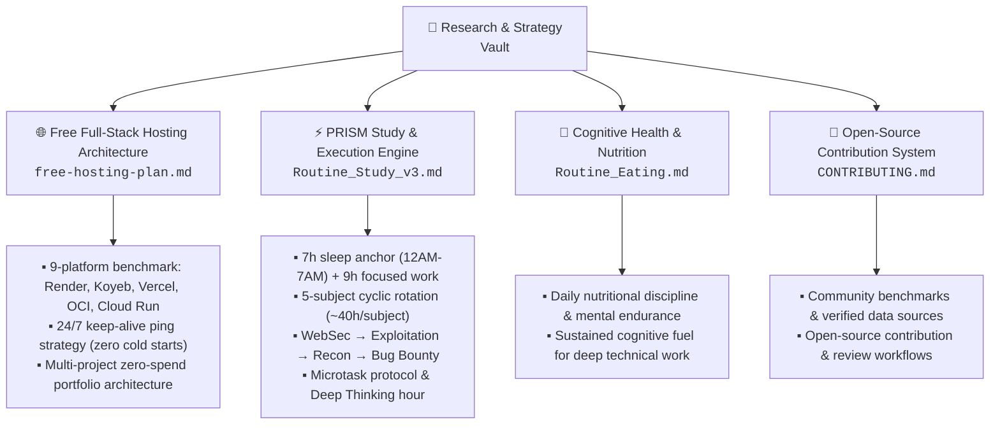

# 📡 research - by Sagar Biswas

*Curiosity is my payload, delivered over POST.*

&nbsp;

&nbsp;

&nbsp;

&nbsp;

&nbsp;

&nbsp;

&nbsp;

A curated collection of production-grade technical research, cloud architecture blueprints, full-stack hosting playbooks, and high-performance study systems. Designed for developers, CSE students, and security practitioners building scalable software on a $0 budget.

---

## 📂 Contents

---

| File | Type | Description |
|---|---|---|
| [free-hosting-plan.md](./notes/free-hosting-plan.md) | 🌐 Cloud Architecture | **The Complete Guide to Free Full-Stack Web Hosting (2026)**. In-depth 9-platform breakdown (Render, Koyeb, Vercel, Oracle Cloud, Google Cloud Run, Fly.io, Zeabur, Glitch, Netlify), cold-start elimination via automated 24/7 keep-alive pings, and zero-dollar multi-project portfolio deployment. |
| [Routine_Study_v3.md](./notes/Routine_Study_v3.md) | 📅 System | **PRISM Study Routine v3**. Battle-tested 2-month advance preparation engine for engineering students. Features a 9+ hour focused schedule, 5-subject cyclic rotation, 4-stage cybersecurity progression, microtask framework, and deep thinking hours. |

> 📌 More technical research notes and cloud blueprints are added on a regular cadence under `notes/`. Star the repository to follow updates.

---

## 🔒 Personal

Private-context documents not intended as shareable research. Stored in `personal/` to keep them separate from public notes.

| File | Description |
|---|---|
| [Routine_Eating.md](./personal/Routine_Eating.md) | দৈনিক খাবারের রুটিন: personal daily nutrition plan (Bengali) |

---

## 🔍 Core Domains & Research Focus

- **Zero-Cost Full-Stack Cloud Hosting**: Practical benchmarks across Render, Koyeb, Vercel, Oracle Cloud (24GB Always Free), Google Cloud Run, and Fly.io
- **Cold Start Mitigation & Uptime Engineering**: Sub-second wake-ups and legal keep-alive automation via free ping schedulers
- **Multi-Project Developer Portfolios**: Hosting 4+ live full-stack services 24/7/365 without paying a dime or hitting shared quota exhaustion
- **Structured Cybersecurity Progression**: Practical roadmap covering web application security, binary exploitation, reconnaissance, and bug bounty hunting
- **High-Throughput Academic Preparation**: The PRISM methodology for mastering complex engineering subjects in cyclic 40-hour deep work rotations
- **Open-Source Strategy**: Reproducible research, data validation, and technical documentation best practices

---

## 🧠 Engineering & Research Principles

All documentation and playbooks in this repository adhere to the following principles:

- **Empirically Verified**: Every hosting limit, idle timeout, memory quota, and command is verified against live platforms and official documentation.
- **Production Usability**: Zero "toy" setups. Every architecture pattern serves both frontend and backend seamlessly under clean routing.
- **Zero-Spend First**: Prioritizing forever-free tiers and credit-card-free providers so students and independent creators can build without financial friction.
- **Living Documents**: Updated continuously as cloud providers revise their free tier allowances and deployment models.

---

## 🚀 Featured Playbooks

### [🌐 free-hosting-plan.md](./notes/free-hosting-plan.md)
**The Complete Guide to Free Full-Stack Web Hosting (2026 Edition)**

A comprehensive breakdown for deploying frontends and backends together under a single URL without paying a dime or facing cold start delays.

#### 🏆 Quick Decision Framework
- ⚡ **Zero Credit Card & Fast Launch:** **Render** (Node.js/Python, auto-deploy from GitHub)
- ⏱️ **Longest Idle Time & Sub-5s Cold Starts:** **Koyeb** (60-minute idle window, free PostgreSQL)
- 🚀 **Next.js & Serverless Frontend:** **Vercel** (Global edge CDN, instant invocations)
- 🏋️ **Raw Compute Beast (Never Sleeps):** **Oracle Cloud (OCI)** (4 ARM cores, 24 GB RAM, 200 GB SSD free forever)
- 📦 **Docker Container Powerhouse:** **Google Cloud Run** (2 million free monthly requests)

#### 🛡️ Master Comparison Summary

| Provider | Free Compute | Idle Timeout | Cold Start | Best Stack | Credit Card? |
|---|---|---|---|---|---|
| **Render** | 512 MB / 0.1 CPU | 15 min | 30 to 50 sec | Node.js, Express, Python | **No** |
| **Koyeb** | 512 MB / 0.1 vCPU | 60 min | 1 to 5 sec | Python, Node.js, Docker | **No** |
| **Vercel** | Serverless Edge | Instant | < 300 ms | Next.js, SvelteKit, Nuxt | **No** |
| **Oracle Cloud** | 24 GB / 4 ARM vCPUs | **Never** | **0 sec (24/7)** | Docker, Any Linux stack | Verification only |
| **Google Cloud Run** | 2M requests/mo | Scale to zero | 1 to 3 sec | Docker, Containers | Verification only |
| **Fly.io** | Up to 3x 256MB VMs | Auto-pause | < 1 sec | Docker, Full-stack apps | Verification only |

> [!TIP]
> **The Free Keep-Alive Secret:** Free hosts sleep when traffic stops. By exposing a lightweight `/api/health` JSON endpoint and pinging it every 10 minutes (for Render) or 45 minutes (for Koyeb) via free services like [cron-job.org](https://cron-job.org), your server stays awake 24/7 with zero cold starts.

[Read Full Free Hosting Guide →](./notes/free-hosting-plan.md)

---

### [📅 Routine_Study_v3.md](./notes/Routine_Study_v3.md)
**PRISM Study Routine v3: 2-Month Advance Preparation & Execution Engine**

A battle-tested daily system for computer science students and engineers balancing academics with high-intensity security engineering:
- **Time Boxing:** 7h sleep anchor (12AM-7AM) + 9h focused deep-work blocks
- **5-Subject Cyclic Rotation:** ~40 hours dedicated per core academic subject
- **Cybersecurity Progression Pipeline:** Web Security → Exploitation → Network Recon → Bug Bounty
- **Protocol:** Microtask execution, 60-minute Pomodoro blocks, and dedicated Deep Thinking hours

[Read Full PRISM Routine →](./notes/Routine_Study_v3.md)

---

## 📬 Connect

- **GitHub:** [@SagarBiswas-MultiHAT](https://github.com/SagarBiswas-MultiHAT)
- **Repo URL:** `https://github.com/SagarBiswas-MultiHAT/research`

Found something useful? ⭐ Star the repo: it helps others discover the research and keeps these guides updated.

Have updated free tier metrics, corrections, or new platforms? [Contributions are welcome](./CONTRIBUTING.md).

---

## 🏷️ Topics & Search Keywords

`free-hosting` · `full-stack` · `cloud-architecture` · `render` · `vercel` · `koyeb` · `oracle-cloud` · `google-cloud-run` · `fly-io` · `docker` · `devops` · `serverless` · `deployment` · `keep-alive` · `cold-starts` · `portfolio` · `cybersecurity` · `web-security` · `cheatsheet` · `developer-tools`

---

All research and cloud plan benchmarks are documented based on active provider terms. Cloud providers frequently adjust free tier quotas, bandwidth caps, and idle timeout policies. Verify specifications with official platform documentation before production deployment.
